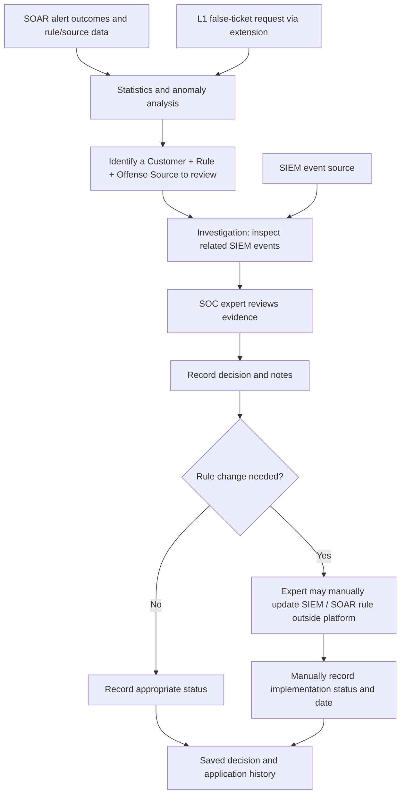
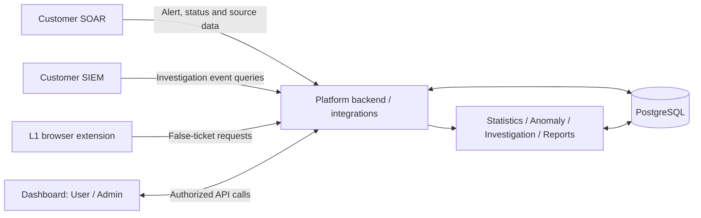

# SOAR Alarm Analysis Platform

> **Project status:** Requirements defined; implementation planning in progress. A **UI-only prototype** exists, but its data and external integrations are simulated. The capabilities below describe the **intended product**, not completed functionality.

## Overview

The **SOAR Alarm Analysis Platform** is a multi-customer security operations **analysis and decision-support system**. It helps SOC teams identify detection rules and offense sources that generate excessive **false positives (FP)**, investigate those findings using related **SIEM events**, and document an expert's decision with supporting evidence.

Its objective is to **reduce unnecessary alert workload without overlooking genuine threats**. The platform is designed to answer four practical questions:

1. **Where is the problem?** Identify problematic **Customer + Rule + Offense Source** combinations through statistics, anomaly detection, and false-ticket reports.
2. **Why is it happening?** Correlate SOAR alert outcomes with relevant SIEM events during an investigation.
3. **What did the analyst decide?** Record the expert's assessment and supporting notes.
4. **Was the decision implemented?** Let the expert manually record the implementation status and date, without the platform changing the rule.

**Scope boundary:** The platform **does not automatically change, deploy, or tune detection rules in connected SIEM/SOAR systems**. The current scope is evidence-based analysis, **human decision recording, and manual tracking of whether a decision was implemented and when**. Any rule modification takes place **outside the platform**, performed by the SOC expert directly in the appropriate SIEM/SOAR system. Automated tuning recommendations are also not part of the current scope.

## Planned Capabilities

### 1. Statistics

Identify high-FP rules and the sources that trigger them, without turning the statistics view into a raw-log explorer.

- Customer overview with the last 30 days' alert counts and FP rates.
- Customer-level analysis for **7, 30, or 90 days**, including TP/FP totals, rates, daily trends, and ranked rules.
- Rule-level details including descriptions, conditions, trigger counts, and the breakdown of associated offense sources.
- **Rule + Offense Source** detail showing TP/FP outcomes, closure by customer versus analyst, and recorded closure reasons.
- Direct navigation from a problematic source to **Investigation**.

### 2. Anomaly Detection

Find unusual increases in alert volume relative to a combination's historical behavior.

- **Rule-based mode:** Analyze each **Customer + Rule + Offense Source** combination.
- **Server-based mode:** Analyze a **Customer + Server** using the combined alerts from all contributing rules.
- Compute a historical baseline separately for **weekdays** and **weekends**.
- Use a configurable threshold:

  ```text
  threshold = max(daily_baseline_average × multiplier, minimum_alert_threshold)
  anomalous = today's_alert_count > threshold
  ```

- Initial specification defaults: **30-day baseline** (allowed 7–90 days), **2× multiplier**, and **10-alert minimum threshold**.
- Show the average, current count, threshold, deviation, detection date, and time-series details; link to the relevant investigation.
- Evaluate anomalies through a backend-scheduled process in the real product, rather than only when opening a page.

### 3. Investigation

Bring the **SOAR outcome** and **SIEM evidence** together for a selected **Customer + Rule + Offense Source + Time Range**.

- Launch an investigation directly or from **Statistics**, **Anomaly**, or **False Ticket** with the relevant context prefilled.
- Summarize SOAR alert count, TP/FP rates, and related SIEM event totals.
- Explore event timelines and filterable event records (for example: time, host, user, event type, process, and command).
- Examine frequent hosts, users, processes, and recurring command patterns.
- Show rule context and evidence-based findings **without the system making the tuning decision**.
- Save an expert decision and notes, and reopen previously saved investigations.
- Let the expert **manually record the implementation status and implementation date** after handling any associated rule change outside the platform. A saved recommendation is **not** proof that the change was applied.

Supported **expert decision categories** in the specification:

- No action required
- Rule tuning required
- Threshold review
- Exclusion candidate
- Further investigation required

These entries **document an analyst's assessment**. Selecting one does not alter the rule in a connected system. The implementation status and date are separate, manually entered information; the platform does not independently verify a change in an external system.

### 4. Inventory & Data-Flow Health

Monitor the availability and responsiveness of both platform services and customer integrations, because missing data can make analysis misleading.

- Track platform dependencies such as the database, cache, message queue, analysis service, and dashboard API **where those components are deployed**.
- Track per-customer SOAR API connectivity, incoming alert freshness, and SIEM/log-source connectivity.
- Present **Healthy**, **Slow**, and **Down** states, with recent checks, response/lag measurements, and 24-hour availability history.
- Detect a stalled alert feed even when the upstream service itself is reachable.

The exact health-check methods, frequencies, and infrastructure components remain to be defined.

### 5. False Ticket Management

Allow **L1 SOC analysts** to submit suspected false-positive cases through a **separate browser extension**. The dashboard is used by authorized users to review and manage those requests.

- Track customer, title, description, alarm, rule, offense source, alarm timestamp, SOAR link, requester, and creation date.
- Support **Open**, **In Progress**, **Resolved**, and **Rejected** statuses.
- Filter requests by customer and status; update request details and status.
- Navigate from a request to the relevant **Investigation** or **Statistics** context.
- Enforce customer-specific visibility.

The request-creation form in the existing UI demo only **simulates** the extension workflow; the real extension-to-platform integration is not implemented yet.

### 6. Monthly Reports

Review alert quality by customer and rule over time.

- Select a customer or all authorized customers and a reporting month.
- Report alert totals, TP and FP counts, and TP/FP rates for each rule.
- Highlight rules with an **FP rate of 70% or greater** and identify the customer's highest-FP rule.
- Export to **Excel**, with a separate worksheet for each customer and percentage-formatted rates.
- Restrict both on-screen results and exports to authorized customers.

Automatic end-of-month generation and emailed reports are **not** in the current scope.

### 7. Administration, Authentication & Access Control

Support a multi-customer SOC workflow with two dashboard roles:

| Role | Intended access |
| --- | --- |
| **User** | Statistics, Anomaly, Investigation, Inventory, False Ticket, and Monthly Reports for authorized customers only. |
| **Admin** | All User capabilities plus user management, customer configuration, access assignments, and anomaly settings; visibility across active customers. |
| **L1 analyst** | Opens False Ticket requests through the separate extension; access to the web dashboard is not assumed. |

Administration includes user lifecycle and role assignment, customer activation/deactivation and connection configuration, per-user customer access, and configurable anomaly thresholds. The real product must enforce authentication and tenant authorization **on the server**, not only by hiding UI elements.

## How the Platform Is Intended to Work



This is a **functional workflow**, not a finalized service/deployment diagram. The rule-change step is **a human action outside this application**, not a platform integration or write-back API. Decisions requiring no change can be recorded without a rule update; the expert records the applicable implementation status manually. **Before/after effectiveness measurement is not a committed MVP capability** and remains a future design consideration.

## High-Level Technical Direction

The technical architecture is still being finalized. The following decisions have been made so far:

| Area | Decision / status |
| --- | --- |
| Deployment direction | **On-premise-oriented** to support customer-managed environments; exact model still under evaluation. |
| Initial development/deployment | **Docker Compose**; Kubernetes is not required for the first iteration. |
| Primary database | **PostgreSQL**; tables, retention policy, and migrations remain to be designed. |
| SIEM and SOAR integrations | Required, but target products, API contracts, authentication, and ingestion/query strategies are **not finalized**. |
| Cache / message queue | Mentioned as potential monitored infrastructure in the product specification; **specific components have not been chosen**. |
| Development lab | Environment and access method **not finalized**. |
| Collaboration | GitHub Flow, Conventional Commits, at least one PR approval (with a documented solo exception), and Squash and merge. |

### Conceptual Integration View



This diagram shows **logical responsibilities**, not confirmed microservices or a fixed data transport. Real connectors, background jobs, infrastructure health checks, and service boundaries will be designed during implementation. **Neither diagram includes any rule-modification interface.**

## Data & Security Requirements

**SOAR data required:** Alarm identifier and link; timestamp; customer; rule name, description, and conditions; offense source and its type; TP/FP closure result and time; who closed the alert; and the closure reason.

**SIEM data required:** Queryable events for the relevant customer, rule, offense source, and time range; event timestamps and fields such as host, user, event type, process, and command; and aggregate queries for event counts and recurring patterns.

**Platform-owned data:** Users, customers, permissions, settings, false tickets, saved investigation decisions and notes, **manually recorded implementation statuses and dates**, and infrastructure/data-flow checks.

Real-product requirements include:

- **Server-side tenant isolation and authorization**, including report exports and investigation records.
- Secure password handling, backend-enforced sessions/roles, and **secret management** for integration credentials.
- Using SIEM-side aggregate queries where appropriate to avoid unnecessarily transferring large volumes of raw events.
- Explicit monitoring of data freshness, since successful API connectivity alone does not establish that feeds are current.

**Critical dependency:** We must verify that each intended SOAR/SIEM provider actually exposes the required fields and queries. The source specification marks this validation as a major project risk.

## Current State vs. Intended Product

The existing demo is a **front-end prototype**, not an operational security integration. Its alerts and SIEM events are simulated; it does not connect to real SOAR/SIEM systems.

| Area | UI prototype | Real product requirement |
| --- | --- | --- |
| Alarm and SIEM data | Sample/simulated | Actual SOAR data and SIEM queries |
| Authentication | Demonstration-only | Secure server-side authentication and roles |
| Multi-customer access | Interface-level filtering | Server-side access checks and tenant isolation |
| Users, tickets, decisions | Browser-side demo storage | Persistent backend database |
| Rule-change follow-up | Not specified in original demo | Expert manually records implementation status and date; no external rule update by platform |
| Anomaly evaluation | Calculated in the demo | Scheduled backend processing with stored results |
| Health checks | Simulated | Real service/connectivity/feed-freshness checks |
| False Ticket intake | Simulated request form | Real browser-extension submission path |
| Excel reports | Generated from demo data | Real, access-controlled report exports |

No production deployment, usable connector, or reproducible local runtime is claimed to exist yet.

## Out of Scope (Current Project)

- **Automatically applying, deploying, or updating detection rules in external SIEM/SOAR systems.** Manual changes by experts are recorded, not executed, by the platform.
- Automatically verifying that a rule change was applied in an external system.
- Automatic before/after rule-effectiveness measurement (not committed to the current MVP).
- **AI-generated automatic rule-tuning recommendations.**
- Extracting IOCs/IOAs from alarm artifacts.
- Automatically emailing or scheduling monthly reports.
- Additional administration features not yet specified (for example, notifications and an audit-log module).

## Open Design Questions

Before implementation, the team still needs to validate or decide:

- Which **SOAR and SIEM products** will be supported first, and which required data fields/queries they provide.
- Whether analysis keys are limited to **offense source** or may include rule-specific fields (for example, command or destination port).
- How **open/unclosed alerts** affect TP/FP totals and rates.
- Whether and how to handle **working-hours versus after-hours anomalies**.
- How the L1 **extension authenticates and submits requests**, and whether ticket assignment is needed.
- Inventory check methods, polling frequency, and product-level source monitoring.
- The permitted **implementation-status values**, how to record a decision that requires no rule change, and whether application date is mandatory for particular statuses.
- Whether future versions will compare TP/FP metrics **before and after** a manually recorded change; no such tracking is currently committed.
- Concrete backend services, API contracts, schema, deployment lab, and network/access boundaries.

These are **open decisions**, not hidden assumptions or implemented behaviors.

## Getting Started

A reproducible setup is **not available yet**. Docker Compose and PostgreSQL are initial design choices, but working Compose files, service configuration, credential examples, and setup commands have not yet been established. This section will be completed when the first runnable lab is committed.

## Development Roadmap

- [x] Define the product goal and the seven functional modules.
- [x] Document the UI prototype and distinguish it from the real product.
- [x] Select PostgreSQL and Docker Compose as initial choices.
- [x] Agree on a contribution and pull-request workflow.
- [ ] Validate a first SOAR/SIEM pair and required data access.
- [ ] Finalize MVP boundaries, data model, auth/tenant boundaries, and lab setup.
- [ ] Implement the backend, persistent records, and initial integration path.
- [ ] Connect core statistics and anomaly analysis to real data.
- [ ] Implement SIEM-backed investigation and expert decision history.
- [ ] Implement manual recording of rule-change implementation status and date, separate from the original decision (without any write-back to SIEM/SOAR).
- [ ] Integrate false-ticket intake, inventory health checks, and monthly exports.
- [ ] Add automated tests, CI checks, and operational documentation.

The roadmap is directional and **does not imply that these features have already been shipped**.

## Contributing

See [CONTRIBUTING.md](CONTRIBUTING.md) for branch naming, commit conventions, pull-request review, and merge rules. Each branch must address **one clearly named task, issue, or feature**.

## License

No license has been selected. Do not assume this repository is open source until an explicit license is added.
